  

I build **tooling for AI coding agents** and ship indie SaaS from Lomé, Togo.

Most of my work sits on the unglamorous half of agent reliability: hand the model the right context, then fail the build the moment that context stops being true.

**Shipping now:** `hermes-project-oracle` 2.3.0 — generate `AGENTS.md`/`CLAUDE.md` from a repo, detect drift in CI, score the file for rules the code cannot actually verify.

---

### Tools for agents

| Project | The problem it solves | Install |
| :--- | :--- | :--- |
| [**hermes-project-oracle**](https://github.com/iruzen-dono/hermes-project-oracle) | Context files rot silently. Scan the repo → generate the context file → `oracle-check` fails CI on drift → `oracle-lint` flags unfalsifiable rules. | `pip install hermes-project-oracle` |
| [**memory-vault**](https://github.com/iruzen-dono/memory-vault) | Sessions disappear into chat history. Packs them into portable `.hermes-memory` context packs. | `pip install hermes-memory-vault` |
| [**hermes-plugin-gen**](https://github.com/iruzen-dono/hermes-plugin-gen) | Writing a Hermes Agent plugin by hand. Generates a working scaffold from a description. | — |
| [**workless**](https://github.com/iruzen-dono/workless) | Workflow automation you can self-host: visual DAG builder, webhooks, scheduling (Laravel + Next.js + React Flow). | — |
| [**portfolio-terminal**](https://github.com/iruzen-dono/portfolio-terminal) | A portfolio that is not a dashboard template — 30+ commands, virtual filesystem, fr/en. | [live](https://portfolio-terminal-lake.vercel.app) |

### SaaS

Product work lives in private repos. The public one:

- [**XEARN**](https://github.com/iruzen-dono/XEARN) — pan-African digital micro-income platform. NestJS 11 + Next.js 15 + Expo, 40+ endpoints, mobile money payments.

Private: **Quotask** (proposals & invoicing, Lemon Squeezy billing) · **LandlordKit** (rental management, 1–10 units) · **TradeQuote** (quoting with line items, tax, PDF, public accept/decline). All Next.js + Drizzle + Neon.

---

### GitHub

Cards are generated from the GitHub and PyPI APIs by [`scripts/readme_stats.py`](scripts/readme_stats.py) and refreshed every day — no third-party widget that can go down or start charging.

---

### Open source · merged upstream

| Repo | Pull requests |
| :--- | :--- |
| [**medusajs/medusa**](https://github.com/medusajs/medusa/pull/16006) | `#16006` — admin: handle deleted stock locations in the order fulfillment section |
| [**neomjs/neo**](https://github.com/neomjs/neo/pulls?q=is%3Apr+author%3Airuzen-dono+is%3Amerged) | `#20834` — hold a curated issue for three days, not seven · `#20839` — publish count when a batched update closes |
| [**hermes-browser-extension**](https://github.com/abundantbeing/hermes-browser-extension/pulls?q=is%3Apr+author%3Airuzen-dono+is%3Amerged) | 6 merged: multi-tab context picker, slash commands, DOM chip states, ESLint/Prettier, delegation results, model picker |
| [**keisary/KeycePass**](https://github.com/keisary/KeycePass/pull/1) | `#1` — password manager fix |
| [**meta/prophet**](https://github.com/facebook/prophet/pull/2784) | `#2784` — open: require `cmdstanpy` 1.3.2 so Windows source builds stop fetching a retired Rtools URL |

### Recent activity

- `2026-11-13` — **neomjs/neo**: batched collection updates now publish their count when they close
- `2026-11-12` — **hermes-project-oracle 2.3.0**: `oracle-lint` sorts every rule into confirmed, contradicted, or unfalsifiable
- `2026-11-12` — CI on **workless** (Laravel suite against PostgreSQL 16 + Next.js build), **trade-quote** and **portfolio-terminal**
- `2026-11-12` — **portfolio-terminal**: résumé as a downloadable PDF in three variants, plus an Open Graph image
- `2026-11-12` — **hermes-memory-vault 0.2.0** on PyPI via Trusted Publishing, no stored token
- `2026-08-15` — **medusajs/medusa**: deleted stock locations no longer break the fulfillment panel

---

Python · TypeScript · Next.js · NestJS · Laravel · React · Expo · PostgreSQL · Drizzle · Prisma · Docker · Neon · Stripe

### Reach me

- X — [@iruzendono](https://twitter.com/iruzendono)
- Discord `@iruzenn` · Telegram `@Am_The_CEO`
- An agent answers for me — [@Comphermes_bot](https://t.me/Comphermes_bot)
- Lomé, Togo 🇹🇬

  
    <a href="https://github.com/iruzen-dono?tab=repositories">All repos</a> ·
    <a href="https://portfolio-terminal-lake.vercel.app">Portfolio</a> ·
    <a href="https://pypi.org/project/hermes-project-oracle/">PyPI</a>
  

